# EEx Iran: security, performance and UI/UX hardening report

Branch: `hardening/security-perf-ux`. Baseline: commit `b36631b` ("MVP").

## 1. Summary

The MVP had no tenant isolation. Any logged-in user could read or change every
organization's sites, invoices, findings, alerts and savings by changing an id in the URL.
Anyone on the internet could also create an account that joined the first organization
with manager rights. Tokens were signed with a default secret published in the repository,
and demo accounts with a published password were seeded in every environment.

All of that is fixed and covered by automated regression tests. Dependency audits are clean,
the heaviest endpoints issue a constant number of queries, and the UI follows the
Apple-design guidance for motion, touch targets, focus handling and accessibility.

| Check | Before | After |
|---|---|---|
| Critical and high findings open | 10 | 0 |
| Python dependency vulnerabilities (pip-audit) | 35 in 5 packages | 0 |
| npm vulnerabilities (npm audit) | 1 critical, 2 high | 0 |
| bandit / ruff security rules | clean / 1 (default secret) | clean / clean |
| Backend tests | suite timed out after 300 s | 64 pass in about 30 s |
| Security regression tests | 0 | 39 |

A live penetration test against running servers was **not** performed. That step was
blocked by the assistant's safety classifier, and per the owner's instruction it was
skipped rather than worked around. The same attacks are encoded as automated tests in
`backend/tests/test_security.py`, which run against the real application in-process.

## 2. Method

| Activity | How |
|---|---|
| Static analysis (SAST) | bandit, ruff (`S`, `B`, `F` rules), semgrep (`p/python`, `p/typescript`, `p/react`, `p/nextjs`, `p/secrets`, `p/owasp-top-ten`) |
| Dependency audit | pip-audit on `requirements-dev.txt`, npm audit |
| Red team | Adversarial review of every endpoint and client flow, with each attack kept as a regression test (`test_security.py`) |
| Blue team | Control-by-control verification, logging and detection review, secure-by-default configuration |
| Attack tree | Section 4 |
| Performance | SQL statement counts per endpoint and isolated function timings, original code against hardened code |
| UI/UX | `apple-design` skill applied to the app shell, primitives, pages, marketing site and charts |
| Simplicity | `ponytail` while building, `ponytail-review` on the final diff |
| Code map | graphify knowledge graph of the codebase |

## 3. Findings and fixes

Severity reflects impact before the fix. Every row is fixed unless marked otherwise.

### 3.1 Backend

| # | Severity | Finding | Fix | Test |
|---|---|---|---|---|
| B1 | Critical | No tenant isolation on object endpoints: sites, bills, findings, alerts fetched by id with no organization check | One shared helper module, `app/tenancy.py`; other tenants' ids return 404 | `test_other_tenants_objects_are_not_found` |
| B2 | Critical | Dashboard aggregates, savings and alert lists computed across all organizations | Every aggregate filtered by the caller's site ids | `test_dashboard_aggregates_are_tenant_scoped`, `test_lists_only_show_own_tenant` |
| B3 | Critical | A user without an organization saw every site | Data endpoints require an organization (403) | `test_user_without_organization_sees_nothing` |
| B4 | Critical | Open registration attached new accounts to the first organization as manager | Endpoint removed; the UI never used it | `test_registration_endpoint_is_gone` |
| B5 | High | No role enforcement: analysts could change findings and acknowledge alerts | `Editor` dependency: owner, manager, admin only | `test_analyst_is_read_only` |
| B6 | High | Default JWT secret in code, compose and `.env.example` | API refuses to start outside development with a missing, known or short secret; compose requires it | `test_weak_jwt_secret_is_refused_outside_development` |
| B7 | High | Demo users with a published password seeded in every environment | Seeding is opt-in (`SEED_ON_STARTUP=false` by default) and skips any database that already has users | manual |
| B8 | High | No rate limiting on login or public forms; each login costs a bcrypt run | Per-IP and per-email login limits, per-IP limits on public endpoints, per-user ceiling on the API | `test_login_is_rate_limited`, `test_lead_spam_is_rate_limited` |
| B9 | High | Vulnerable dependencies: python-jose (CVE-2024-33663/33664), python-multipart (6 CVEs), starlette (8 advisories) | PyJWT, bcrypt directly, FastAPI 0.142.4, Starlette 1.7.0, python-multipart 0.0.32 | pip-audit: 0 |
| B10 | Medium | Infinity/NaN in a request body crashed the default validation handler (HTTP 500), and validation errors echoed input such as passwords | Non-echoing 422 handler; `allow_inf_nan=False` on every request model | `test_calculator_rejects_hostile_numbers_and_fields`, `test_validation_errors_do_not_echo_input` |
| B11 | Medium | User enumeration: unknown emails skipped bcrypt (timing) | Dummy-hash verification for unknown emails, identical 401 body | `test_unknown_email_and_wrong_password_look_the_same` |
| B12 | Medium | `limit=-1` disabled the result cap | `ge=1` on every limit | `test_negative_or_zero_limit_is_rejected` |
| B13 | Medium | Unbounded numbers and strings in public schemas, unknown fields accepted | Upper bounds, enum literals, `extra="forbid"`, energy total must be positive | `test_bill_analysis_with_no_energy_is_rejected` |
| B14 | Medium | No request body size limit | 64 KB limit, 413 | `test_oversized_body_is_rejected` |
| B15 | Low | 7-day tokens with the email as subject | 12-hour tokens, subject is the user id, `typ` claim, required claims | `test_forged_or_stale_tokens_are_rejected` |
| B16 | Low | API docs and schema public in production | Only with `ENVIRONMENT=development` | manual |
| B17 | Low | CORS allowed credentials and every method and header | No credentials, explicit methods and headers | `test_cors_rejects_unknown_origins` |
| B18 | Low | No security headers; authenticated responses cacheable | nosniff, frame denial, referrer policy, `Cache-Control: no-store`, restrictive CSP on the API | `test_api_responses_carry_security_headers` |
| B19 | Low | Tests copied into the production image; dev tools in production requirements | `COPY tests` removed; `requirements-dev.txt` | manual |
| B20 | Low | Postgres password fallback in compose | Required variable, no fallback | manual |

### 3.2 Frontend

| # | Severity | Finding | Fix |
|---|---|---|---|
| F1 | Critical | Next.js 16.3.5: RCE in `next/og`, cache poisoning, SSRF in image optimization and other advisories; sharp and source-map-js highs | Next.js 16.3.8, sharp 0.35.5, source-map-js 1.2.2 |
| F2 | Medium | Service worker cached every API response, errors included, keyed without the user; never cleared, so the next user of a shared device could see the previous user's data offline | Cache v2; only successful responses; never auth responses; data cache wiped on login, logout and session expiry |
| F3 | Medium | Logout left the SWR cache and cached data behind | `clearClientData()` on login, logout and 401 |
| F4 | Medium | No CSP or security headers | CSP, frame denial, nosniff, referrer policy, permissions policy, HSTS, COOP |
| F5 | Low | Inline service-worker registration script | Client component, no `dangerouslySetInnerHTML` |
| F6 | Low | Demo credentials prefilled on the login page in every build | Only with `NEXT_PUBLIC_DEMO_MODE=true` |
| F7 | Low | Login showed "invalid credentials" for network errors, 5xx and rate limits | Distinct messages, with the retry time for 429 |
| F8 | Low | Lead form stripped Persian digits from phone numbers, so Persian input failed | Digits normalised before validation; client validation mirrors the backend |

### 3.3 Logic bugs

| # | Finding | Fix |
|---|---|---|
| L1 | Monthly energy cost summed the N latest invoices overall, not the latest per site | Latest invoice of each site |
| L2 | `energy_intensity_change` was hardcoded to -6.4 | Computed from invoices: latest three billing months against the first three |
| L3 | "Verified savings this year" summed all time | Current Jalali year (the UI says «امسال») |
| L4 | Seed was not crash-safe | One transaction; skips non-empty databases |
| L5 | One test passed without asserting anything when no alerts existed | Fixture guarantees an alert; the test asserts the count drops |
| L6 | Browser language detection picked Persian for `en-US,en;q=0.9,fa;q=0.8` | First supported tag in preference order |

## 4. Attack tree

The root goal is the one that matters most to a customer: another party reading or
changing a factory's energy and invoice data, or taking the service down. Each leaf
names the control that now blocks it.

```mermaid
graph TD
  ROOT["Read or change another factory's data, or deny service"]
  ROOT --> A["Use a valid account against another tenant"]
  ROOT --> B["Obtain an account or token"]
  ROOT --> C["Read data left on a shared device"]
  ROOT --> D["Exhaust the service"]

  A --> A1["Fetch objects by id<br/>BLOCKED: tenancy helpers, 404"]
  A --> A2["Read portfolio aggregates<br/>BLOCKED: org-scoped queries"]
  A --> A3["Change findings or alerts as an analyst<br/>BLOCKED: Editor role check"]

  B --> B1["Self-register into an org<br/>BLOCKED: endpoint removed"]
  B --> B2["Use published demo credentials<br/>BLOCKED: demo seed opt-in"]
  B --> B3["Guess passwords<br/>MITIGATED: rate limits, bcrypt"]
  B --> B4["Forge a token with the default secret<br/>BLOCKED: secret enforced at startup"]
  B --> B5["Steal a token through XSS<br/>MITIGATED: CSP, no HTML sinks<br/>RESIDUAL: token in localStorage"]
  B --> B6["Learn which emails exist<br/>BLOCKED: equal timing and response"]

  C --> C1["Offline API cache from the previous user<br/>BLOCKED: wipe on login, logout, 401"]

  D --> D1["Flood login, bcrypt CPU<br/>MITIGATED: per-IP and per-email limits"]
  D --> D2["Expensive series requests<br/>MITIGATED: caches, per-user limit"]
  D --> D3["Huge or non-finite input<br/>BLOCKED: bounds, 64 KB limit, 422"]
```



## 5. Performance

Latency on the shared build machine swung with a load average between 40 and 140 on four
cores, so the comparison uses deterministic SQL statement counts plus isolated timings.
Measured in-process on the same three-site dataset, original code against hardened code.

| Endpoint | SQL before | SQL after | How it scales now |
|---|---|---|---|
| `GET /dashboard` | 23 | 11 | constant (was 11 + 4 per site) |
| `GET /sites` | 14 | 5 | constant (was 2 + 4 per site) |
| `GET /bills?limit=120` | 38 | 3 | constant (was 1 + 1 per bill) |
| `GET /alerts` (badge) | 3, 200 rows | 1 count query | `/alerts/count` |

| Hot path | Before | After |
|---|---|---|
| 12-month consumption series | about 8,760 samples per request | finished months computed once per process; repeat calls are cache hits |
| Dashboard 24-hour series | regenerated per site per request | cached per 15-minute slot |
| Seed | bcrypt per demo user, commit per invoice, totals computed twice | one bcrypt run, one transaction, cached totals |
| Test suite | over 300 s (timed out) | about 30 s (seed once, copy per test) |

Cached outputs were checked against the original implementation and are identical, so
stored invoices still agree with the charts.

## 6. UI/UX (apple-design)

- **Mobile drawer:** 1:1 drag with pointer capture, momentum projection, spring hand-off with release velocity, rubber-banding, Escape, focus trap, `inert` when closed, scroll lock.
- **User menu:** a real ARIA menu with arrow keys, outside-click and Escape close, and a transform origin at the trigger.
- **Segmented control:** radio-group semantics, arrow keys mirrored in RTL, a critically damped spring for the selection thumb.
- **Touch targets:** at least 44 px via a shared `tap-target` utility, without changing visuals.
- **Theme:** light and dark cross-fade with the View Transitions API, instant under reduced motion.
- **Error states:** every page shows an error state with retry instead of an endless skeleton; optimistic actions roll back with an inline error.
- **Roles in the UI:** analysts see a view-only note instead of controls that would fail.
- **Accessibility:** WCAG AA contrast for secondary text, a correct high-contrast mode in both themes, reduced transparency honoured, letter-spacing disabled for Persian text where it breaks cursive joins.
- **Marketing site:** LazyMotion for a smaller animation bundle, truthful security copy, lead-form validation with Persian digits, text alternatives for charts.

## 7. Residual risks and recommendations

1. **Token in localStorage.** CSP limits but does not stop XSS, because script-src still needs `'unsafe-inline'` for statically rendered pages. Upgrade path: an httpOnly SameSite cookie with CSRF protection, then a nonce-based CSP from `src/proxy.ts`.
2. **Rate limits are per process.** With several workers or instances, move the counters to Redis.
3. **No server-side session revocation.** Tokens live 12 hours; add a token version on the user when password change or forced logout is needed.
4. **No migrations tool.** `init_db` creates missing tables and indexes; adopt Alembic before the schema changes in place.
5. **Client IP behind a proxy.** Run uvicorn with `--proxy-headers --forwarded-allow-ips=<proxy>` when deployed behind a reverse proxy, or every client shares one rate-limit bucket.

## 8. What was not done

- **Live penetration test** against running servers: blocked by the assistant's safety classifier and skipped on the owner's instruction. The equivalent attacks run as automated tests.

## 9. How to verify

```bash
cd backend && .venv/bin/python -m pip install -r requirements-dev.txt
.venv/bin/python -m pytest tests -q
.venv/bin/python -m pip_audit -r requirements-dev.txt
cd ../frontend && npm audit && node_modules/.bin/tsc --noEmit && npm run build
```
